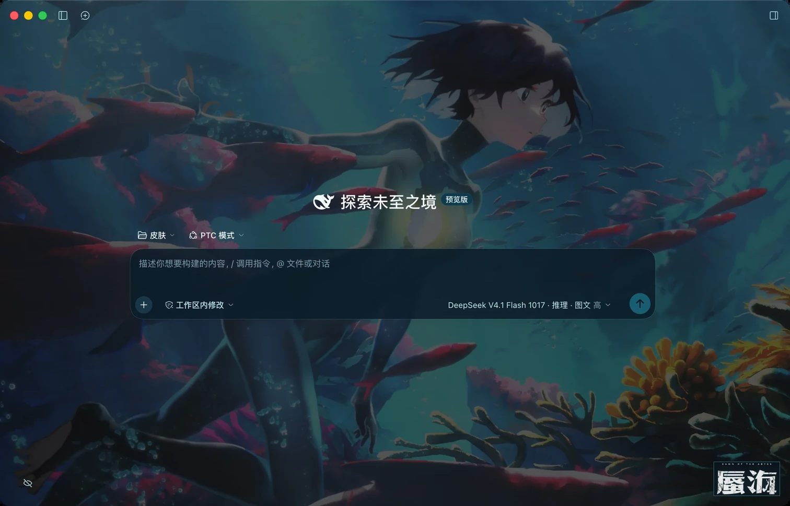

# dsh-shenhai-skin · DSH 动态皮肤

Steam游戏《蜃海》官方提供的DeepSeek Harness动态皮肤插件：外壳变成一层半透明玻璃，聊天区、侧栏、右侧面板都能透出视频；菜单、代码块和输入框保留足够的不透明度，保证可读性。右下角有一个玻璃质感的小按钮，可随时开关、调整界面不透明度、背景虚化和画面压暗。

> 内置视频为 `assets/skin.mp4`（2560×1440，8 秒循环），随插件一起安装；也可以在配置里用 `videoPath` 指向自己的视频。



## 特性

- **循环视频壁纸**：`<video loop muted autoplay playsinline>`，窗口切到后台时自动暂停，回到前台继续播放。
- **单层玻璃外壳**：皮肤启用时把主题的 `--dsw-alias-bg-base` 与 `--dsw-specific-sidebar-fill` 置为透明，再用一层独立的 tint 元素压在视频上方、界面下方；不会出现「多层半透明背景叠加把视频完全盖住」的问题。
- **深色玻璃（默认开启）**：亮色主题配明亮的动态视频会发灰、文字对比度不足，所以皮肤启用时会把主题切到 `dark`，并在关闭皮肤时恢复你原来的主题偏好（`light` / `dark` / `system`）。也可以在控制面板里关掉「深色玻璃」，保留你自己的主题。
- **四套配色**：控制面板「配色方案」可在 **极光潮汐 Aurora Tide（默认）**、**夜光珊瑚 Coral Night**、**深海极光 Deep Sea Aurora** 和 **原始配色** 之间切换；都只覆盖边框、按钮、气泡、卡片、菜单、代码块、状态色、滚动条等**不透明组件**，透明外壳与视频层保持不变；切换即时生效、可随时回退。
- **可调外观**：界面不透明度（30%–100%）、视频虚化（0–24px）、画面压暗（0–60%）。
- **背景音乐**：内置《浮光》《粼光缓动》两首曲目；可单独选择曲目，并切换「单曲循环」或「双曲循环」；默认关闭，音量 0–100% 可调，关闭皮肤时自动停止。
- **游戏 Logo 按钮**：右下角使用《蜃海》Logo 的深色玻璃直角按钮（108×56），完整显示 DAWN OF THE ABYSS 与「蜃海」字样，带边框、悬停光晕和明确的点击态。
- **侧栏鲸鱼 Logo**：DSH 左上角的 DeepSeek 品牌图形通过 CSS mask 换成插件自带的座头鲸剪影（`assets/humpback.png`），颜色跟随主题文字色，不改 DSH 本体。
- **账号信息隐藏**：账号头像 / 昵称右侧有一个无边框、无底板的透明眼睛图标，点击即可隐藏 / 显示 DSH 左下角的用户头像和昵称；隐藏后该行只剩眼睛图标，账号按钮行本身仍可打开账号菜单；状态保存在本地，关闭皮肤时自动恢复显示。
- **设置宣传图 + Steam 入口**：设置面板顶部显示《蜃海》宣传图，底部是一行内嵌 Steam 链接的宣传文案（链接紧接文案，不强制换行），可直接打开商店页面。
- **中英双语设置**：面板内可切换「中文 / English」；英文版把蜃海译为 **Dawn of the Abyss**，所有设置项与宣传文案同步翻译。
- **跟随主题**：切换浅色 / 深色主题时自动重算玻璃底色。
- **纯本机**：视频、音乐和图片都由 DSH 自己的 HTTP 路由提供，支持 Range、206、ETag 与 304；不上传、不联网。
- **无 React 依赖**：浏览器半侧是一个自包含的 client bundle，只操作 DOM 和 CSS 变量。

## 安装

### 方式一：插件市场（推荐）

在 **设置 → 插件 → 插件市场** 搜索「蜃海」或 `dsh-shenhai-skin`，安装后启用。条目提交在 [awesome-dsh-plugin](https://github.com/awesome-dsh-plugin/awesome-dsh-plugin)，市场与官网会自动收录。

### 方式二：从 GitHub 安装

先完全退出 DeepSeek Harness，然后：

```sh
dsh plugin --profile desktop add github:FYTG-Sprite/dsh-shenhai-skin
```

重新打开 DSH 即可。

### 方式三：安装本地目录（开发 / 本机）

1. 打开 **设置 → 插件 → 安装插件**。
2. 填入你克隆/解压后的插件目录绝对路径，例如：

   ```
   ~/plugins/dsh-shenhai-skin
   ```

3. 安装后启用 `dsh-shenhai-skin`（插件 id 为 `shenhai-skin`）。

本地安装使用 `link:` 依赖，**插件目录必须保留在原处**；移动目录后需要从新路径重新安装。

```sh
dsh plugin --profile desktop add "$HOME/plugins/dsh-shenhai-skin"
```

> **升级提示**：本版新增了宿主侧的 Logo、宣传图和音乐路由。如果你是从旧版热更新到这一版（客户端已生效但图片/音乐 404），请**完整退出并重新打开 DSH** 一次；宿主启动时会注册新路由，设置、主题和皮肤偏好不会丢失。

## 使用

- 右下角的《蜃海》Logo 按钮：打开 / 关闭控制面板。
- **启用皮肤**：总开关；关闭后恢复默认界面，并把主题还原到皮肤开启前的偏好。
- **深色玻璃**：默认开启。开启时切到 dark 主题；关闭时恢复原主题。
- **配色方案**：极光潮汐（默认）/ 夜光珊瑚 / 深海极光 / 原始配色。切到「原始配色」即撤销组件配色；选择保存在本地，重启后仍生效。
- 从 0.4.0 升级时，旧版默认的「夜光珊瑚」会一次性迁移到新的「极光潮汐」；之后手动选择的配色会保留，不会被默认值覆盖。
- **界面不透明度**：控制唯一那层玻璃底色的 alpha；越小视频越明显。
- **背景虚化**：对视频本身做 blur，界面文字保持清晰。
- **画面压暗**：在视频上加一层暗角 / 渐变遮罩。
- **账号隐私**：点击账号昵称右侧的眼睛图标隐藏左下角头像与昵称；再点一次恢复。隐藏后该行只剩眼睛图标，账号按钮行本身仍可打开账号菜单（设置 / 联系 / 退出登录）；账号菜单本身不会被禁用。
- **背景音乐**：默认关闭；打开后按「音乐音量」播放。下方两个下拉框分别选择**曲目**（浮光 / 粼光缓动）和**播放模式**（单曲循环 / 双曲循环）。关闭皮肤会同时暂停音乐。
- **音乐音量**：0–100%，默认 35%；即使音乐关闭也可以先设定音量。
- **语言**：中文 / English。切换后整个设置面板（含宣传文案和 Steam 链接）立即换成对应语言；选择保存在本地。
- **Steam 宣传**：面板最下方是一行「感谢支持蜃海…」文案，**《蜃海》Steam页面** 链接紧跟在文案后面（英文版为 **Dawn of the Abyss on Steam**），点击打开商店页。
- **重新播放 / 恢复默认**：前者从头播放，后者恢复插件默认值（不透明度 72%、虚化 0、压暗 18%、深色玻璃开启、配色方案为极光潮汐、音乐关闭、音量 35%、曲目浮光、双曲循环、账号信息显示、语言保持不变）。
- 滑块值保存在浏览器 `localStorage`（键 `dsh.shenhai-skin.v1`），优先于 `cordis.patch.yml` 里的默认值。

## 设置界面

中文：


English：


面板没有标题栏和「视频循环播放 · 仅本机」提示，打开后直接从宣传图开始。右下角的入口按钮使用《蜃海》Logo：


账号隐私眼睛图标位于左下角账号昵称右侧，只有图标，没有边框和底板。

- 音乐曲目：`assets/music/fuguang.mp3`（浮光）、`assets/music/linguang.mp3`（粼光缓动）。
- 设置弹窗宣传图：`assets/promo.jpg`，放在面板顶部。
- Steam 链接：`https://store.steampowered.com/app/3222720?utm_source=DSH&utm_campaign=store_page_release&utm_medium=0`

## 配色方案

控制面板 → **配色方案**，四选一：

| 选项 | 风格 | 预览 |
| --- | --- | --- |
| **极光潮汐 Aurora Tide**（默认） | 亮青主操作 + 更亮荧光，珊瑚/暖金降饱和 | [预览](<./docs/theme-tide.png>) |
| **夜光珊瑚 Coral Night** | 珊瑚主操作 + 青色荧光，暖冷对比最强 | [预览](<./docs/theme-C-coral-night.png>) |
| **深海极光 Deep Sea Aurora** | 最初版本：深海蓝主操作，青做荧光，珊瑚/暖金做状态 | [预览](<./docs/theme-aurora.png>) |
| **原始配色** | DSH 自带深色配色 | — |

### 夜光珊瑚 Coral Night


- **主操作**：`#E86AA6`（珊瑚），hover `#F584B8`
- **荧光/焦点**：`#5FEFFF`（青）
- **完成/珊瑚**：`#F07DB4`；**警告/暖金**：`#F0C96A`
- **表面**：`#172130` / `#1D2B3D` / `#24364B`
- **亮底文字**：`#1A0B12`（深墨色，保证亮珊瑚/亮青按钮上的对比度）

### 深海极光 Deep Sea Aurora


- **主操作**：`#1B759C`（深海蓝），hover `#2493BF`
- **荧光/焦点**：`#4AEAF3`（青）
- **完成/珊瑚**：`#DE6FAE`；**警告/暖金**：`#E8C55A`
- **表面**：`#101B27` / `#142333` / `#192C3F`
- **亮底文字**：`#F2FBFF`（白字压在深蓝按钮上）

### 极光潮汐 Aurora Tide


- **主操作**：`#22B8D9`（亮青），hover `#3AD2EE`
- **荧光/焦点**：`#6FF7FF`
- **完成/珊瑚**：`#F49AC4`；**警告/暖金**：`#E8D27A`
- **表面**：`#0F1D29` / `#142837` / `#1A3547`
- **亮底文字**：`#04141C`（深墨色，压亮青按钮）

和深海极光的区别：主操作从深蓝 `#1B759C` 提到亮青 `#22B8D9`，荧光从 `#4AEAF3` 提到 `#6FF7FF`，珊瑚/暖金降饱和，表面再深一档，边框更青更强。

**回退**：控制面板 → **配色方案 → 原始配色**；或关闭 **启用皮肤**（同时恢复皮肤开启前的主题偏好）。切换即时生效，选择保存在 `localStorage`。

三套配色都通过 `ctx.theme.overrideTokens('dsh-shenhai-skin', …)` 以临时覆盖层应用，不修改 DSH 源文件，也不会写死主题偏好。透明底色 token 不在覆盖表里，并用 `!important` 兜底。

## 配置（可选）

在 `~/.dsh/profiles/desktop/cordis.patch.yml` 中给 `shenhai-skin` 条目加 `config`：

```yaml
- id: shenhai-skin
  name: dsh-shenhai-skin
  config:
    videoPath: /Users/me/Movies/another-loop.mp4
    opacity: 0.72
    blur: 0
    dim: 0.18
```

| 字段 | 默认 | 说明 |
| --- | --- | --- |
| `videoPath` | 内置 `assets/skin.mp4` | 任意绝对路径的视频文件；MIME 固定按 `video/mp4` 提供，建议使用 H.264 MP4 |
| `opacity` | `0.72` | 玻璃底色不透明度；越小视频越明显 |
| `blur` | `0` | 视频虚化像素（0–24） |
| `dim` | `0.18` | 压暗遮罩强度（0–0.7） |

这些值只在浏览器还没有本地偏好时作为初始值使用；一旦你动过右下角滑块，`localStorage` 里的值就优先。想重新套用 YAML 默认值，点控制面板里的「恢复默认」。

## 工作原理

- **宿主半侧**（`lib/index.js`）：通过 `ctx.webServer` 注册视频、配置、音乐和图片路由：
  - `/dsh-shenhai-skin/video.mp4`：带 `Accept-Ranges`、206 分片、ETag 与 304 的视频流；
  - `/dsh-shenhai-skin/music/fuguang.mp3`、`linguang.mp3`：`audio/mpeg`，同样支持 Range；
  - `/dsh-shenhai-skin/logo.png`、`promo.jpg`：设置按钮 Logo 与弹窗宣传图；
  - `/dsh-shenhai-skin/humpback.png`：侧栏鲸鱼 Logo 的透明遮罩图；
  - `/dsh-shenhai-skin/config.json`：默认值文档。
- **浏览器半侧**（`lib/client.js`）：挂载全屏视频层（`z-index: 0`），把 `#root` 抬到 `z-index: 1`；启用时在 `html[data-dsh-skin="on"]` 下把外壳与侧栏底色置为透明，并在视频层里放一层 `.dsh-skin-tint`（颜色取当前主题的 `--dsw-alias-bg-base`，alpha 由滑块控制）。深色玻璃由 `ctx.theme` 设置并记录原偏好。
- **背景音乐**：一个隐藏的 `<audio>` 元素；单曲循环时 `loop=true`，双曲循环时监听 `ended` 并按 `fuguang → linguang → fuguang` 切换；默认关闭，音量、曲目和模式写入 `localStorage`；关闭皮肤时暂停。
- **账号隐私**：启用且未失败时，在 `<html>` 上加 `dsh-skin-account-hidden`；CSS 只隐藏账号按钮内的头像 / 昵称 span，眼睛按钮是独立 `position: fixed` 图标，按昵称实际位置定位，不占账号行布局；按钮本身和账号菜单保持可用。关闭皮肤、视频加载失败或恢复默认时移除该类。
- **双语面板**：`copy` 在 `ZH` / `EN` 两份字典间切换；语言变化时销毁并重建右下角 launcher，保留面板展开状态和所有设置。
- **配色覆盖**：`CORAL_PALETTE` / `AURORA_PALETTE` / `TIDE_PALETTE` 各以 `{ light, dark }` 成对给出 116 个不透明组件 token；开启时调用 `ctx.theme.overrideTokens('dsh-shenhai-skin', …)`，切换配色、关闭皮肤或卸载插件时 dispose 掉覆盖层。透明底色 token 不在覆盖表里，并用 `!important` 兜底。
- 卸载 / 关闭时移除视频层、音频、样式、监听器与所有 CSS 变量覆盖；关闭皮肤会还原主题。

## 文件

```
dsh-shenhai-skin/
├── assets/skin.mp4     # 内置循环视频（来自用户提供的 高清动态壁纸（PC）.mp4）
├── assets/music/       # 浮光.mp3、粼光缓动.mp3
├── assets/icon-180.png # 插件市场方形图标
├── assets/logo.png     # 设置按钮用的《蜃海》Logo
├── assets/promo.jpg    # 设置弹窗宣传图
├── assets/humpback.png # 侧栏鲸鱼 Logo 遮罩
├── lib/index.js        # 宿主半侧：视频/音乐/图片路由
├── lib/client.js       # 浏览器半侧：壁纸 + 音乐 + 双语控制面板 + 配色
├── cordis.patch.yml    # bundle 插入声明
├── docs/               # 预览与配色图
├── screenshots.json    # 插件市场详情页截图清单
├── package.json
├── LICENSE
└── README.md
```

## 许可证

插件代码以 [MIT](./LICENSE) 发布，© 2026 FYTG-Sprite。

`assets/skin.mp4`、`assets/music/`、`assets/logo.png`、`assets/promo.jpg` 与 `docs/` 中的《蜃海》素材版权归其权利人所有，随插件提供仅用于本插件的演示与个人使用；如果你没有相应授权，请在再分发前替换为自己的素材。
